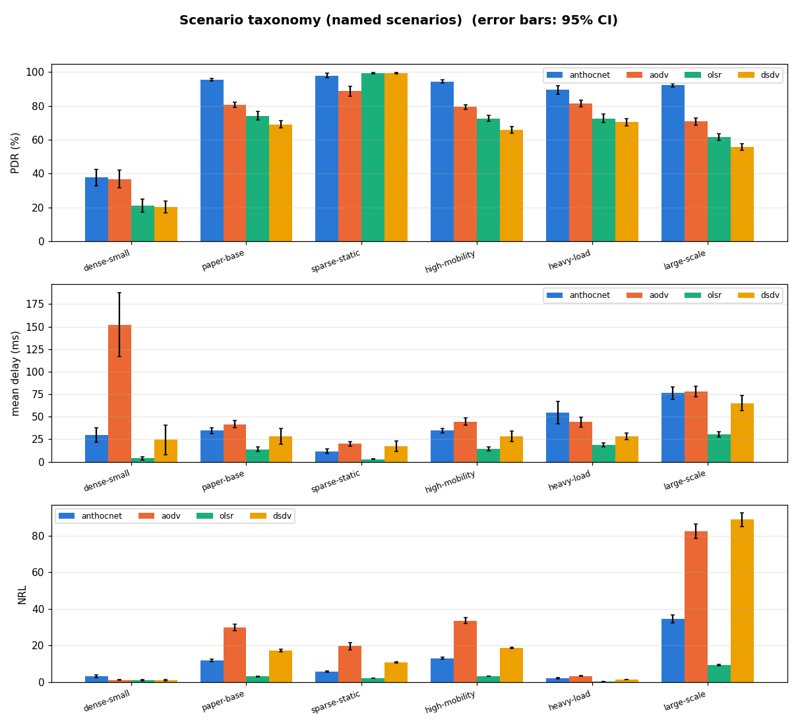
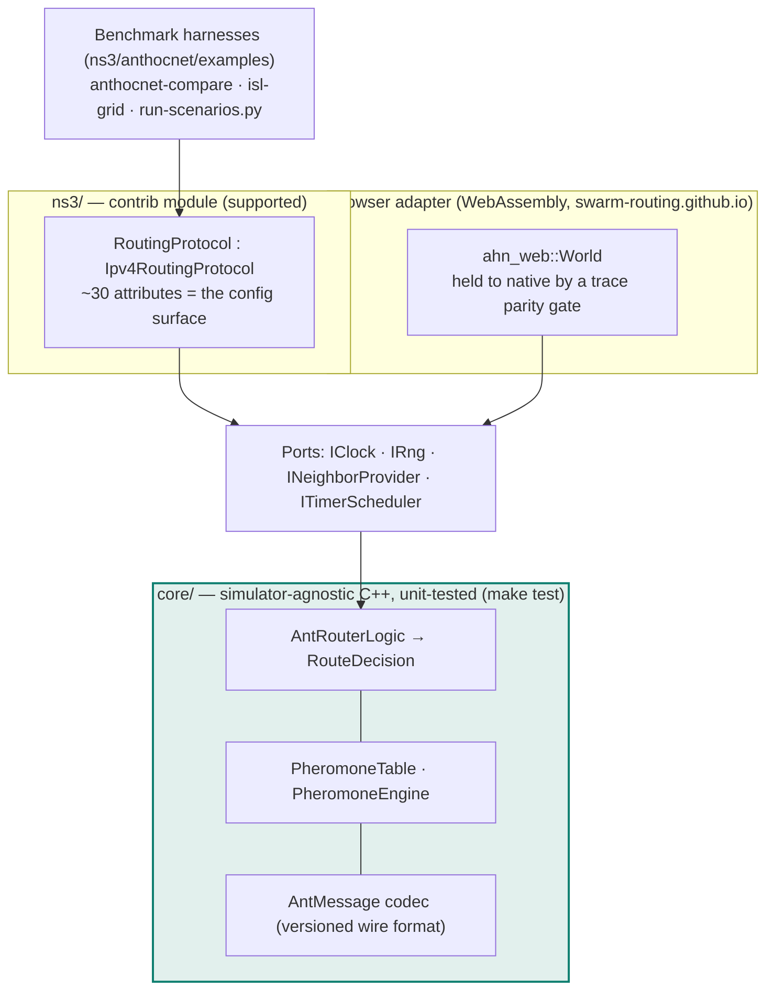

# AntHocNet

<!-- org-sync:begin badges -->
[](https://github.com/swarm-routing/AntHocNet/actions/workflows/ci.yml)
[](https://sonarcloud.io/summary/new_code?id=swarm-routing_AntHocNet)
[](https://sonarcloud.io/summary/new_code?id=swarm-routing_AntHocNet)
[](https://sonarcloud.io/summary/new_code?id=swarm-routing_AntHocNet)
[](https://sonarcloud.io/summary/new_code?id=swarm-routing_AntHocNet)
[](https://coderabbit.ai)
[](https://scorecard.dev/viewer/?uri=github.com/swarm-routing/AntHocNet)
[](https://www.bestpractices.dev/projects/16656)
[](https://doi.org/10.5281/zenodo.20981979)
[](CITATION.cff)
[](LICENSING.md)
[](AGENTS.md)
[](https://www.nsnam.org)
[](https://github.com/orgs/swarm-routing/packages/container/package/ns3-dev)
[](https://www.conventionalcommits.org)
[](https://swarm-routing.github.io/projects/AntHocNet/)
[](https://swarm-routing.github.io/AntHocNet/docs/)
<!-- org-sync:end badges -->
[](https://github.com/swarm-routing/AntHocNet/actions/workflows/ci.yml)
[](https://codecov.io/gh/swarm-routing/AntHocNet)
[](https://github.com/swarm-routing/AntHocNet/releases)
[](#)
[](#)
[](https://codespaces.new/swarm-routing/AntHocNet?quickstart=1)
[](https://github.com/sponsors/danieljoppi)

**▶ [Learn it by playing](https://swarm-routing.github.io/AntHocNet/)** — a city-builder for networks and ants
that runs this repository's routing core, compiled to WebAssembly, in your
browser: place and move phones, break links, and watch the ants find the way.
Code reference: [API docs](https://swarm-routing.github.io/AntHocNet/api/).


**A paper-faithful AntHocNet you can install on a stock ns-3 tree in three
commands** — a drop-in `contrib/` module, no forked simulator. It is benchmarked
against AODV / OLSR / DSDV on identical scenarios under a fixed methodology
(20-seed, 900 s runs; every published number carries a 95% confidence interval —
[methodology](docs/benchmarks/methodology.md)). The algorithm itself is
simulator-independent C++ with its own unit-test suite: `make test` runs it with
no simulator installed. Releases are archived on Zenodo with DOIs, so results
can cite an exact, immutable version.



*AntHocNet vs AODV / OLSR / DSDV across the six named MANET scenarios (error
bars: 95% CI) — current numbers and per-scenario pages in
[docs/benchmarks.md](docs/benchmarks.md).*

An ant-colony-optimization routing protocol for mobile ad-hoc networks,
implemented once as a **simulator-agnostic algorithm core** with a thin
**NS-3** adapter (and a browser adapter that runs the same core as WebAssembly
on the [learn site](https://swarm-routing.github.io/AntHocNet/), the project's front page).

The repository does not bundle a copy of any simulator. You install AntHocNet
onto *your own* NS-3 tree as an additive `contrib/` module (ns-3.36+, with a
`wscript` for older waf builds).

> [!NOTE]
> **NS-2 support was removed in v2.0.0**
> ([#307](https://github.com/swarm-routing/AntHocNet/issues/307)). It was frozen at
> [v1.2.0](https://github.com/swarm-routing/AntHocNet/releases/tag/v1.2.0) and
> shipped through v1.9.0; where to get it, the images and the rationale are in
> **[docs/ns2-support.md](docs/ns2-support.md)**.

```
core/   simulator-agnostic C++ (no simulator dependency) + unit tests
ns3/    native Ipv4RoutingProtocol module
docs/   architecture, configuration, benchmarks, fidelity, ADRs — map in docs/README.md
```

## Why one core, thin adapters

Simulators differ in architecture, so there is no single universal patch. The
algorithm (pheromone table, evaporation/reinforcement, ant construction,
routing decisions) lives in [`core/`](core) and is shared verbatim; each
simulator gets only a thin adapter that converts packets and executes the
decisions the core returns. See [docs/architecture.md](docs/architecture.md)
and [ADR-0023](docs/adr/0023-one-core-one-simulator-adapter.md) for why the
split stays with one simulator adapter.



The full stack — every mechanism, the switch that gates it, and what is
live/inert per network regime — is diagrammed in
[docs/software-layers.md](docs/software-layers.md).

## Quick start

### Run a simulation with zero setup (Codespaces / VS Code devcontainer)

One click gives you a container with ns-3.48 already built ([`.devcontainer/`](.devcontainer/),
on the org's [`ns3-dev`](https://github.com/swarm-routing/ns3-containers) `3.48-debug` image,
pinned by digest); it installs this checkout's AntHocNet module and builds it for you. Locally: clone, then VS Code → *Dev Containers: Reopen in Container*. When the
setup log finishes:

```bash
cd /opt/ns-3
./ns3 run anthocnet-example                          # your first simulation
./ns3 run "anthocnet-compare --nNodes=20 --time=30"  # vs AODV / OLSR / DSDV
```

### Run the core unit tests

```bash
make test
```

(Builds `core/` with CMake and runs the ctest suite — no simulator needed.)

### Install on NS-3

From a checkout:

```bash
make doctor      NS3DIR=/path/to/ns-3      # checks the tree, ns-3 version, CMake, compiler
make install-ns3 NS3DIR=/path/to/ns-3      # BASELINES=0: AntHocNet alone, no comparison arms
cd /path/to/ns-3 && ./ns3 configure --enable-examples --enable-tests && ./ns3 build
./ns3 run anthocnet-example
```

Without a checkout: download `anthocnet-ns3-modules-<version>.tar.gz` from the
[latest release](https://github.com/swarm-routing/AntHocNet/releases/latest), then
`tar -xzf anthocnet-ns3-modules-<version>.tar.gz -C /path/to/ns-3/contrib` and
build as above. The same files are on the generated `ns3-module` branch.

With ns-3's installer, [bake](https://www.nsnam.org/docs/bake/tutorial/html/):
each release from v2.3.0 on attaches `anthocnet-<version>.bakeconf.xml`. Copy
it into your bake checkout's `contrib/` directory, then run
`./bake.py configure -e ns-3.42 -e anthocnet && ./bake.py download && ./bake.py build`.
Any ns-3 from 3.36 works. This builds AntHocNet alone, without the
comparison modules. The recipe is built end to end weekly
([bake.yml](.github/workflows/bake.yml)).

Uninstall: `make uninstall-ns3 NS3DIR=...`. Tested: every PR on the ns-3
release ns-3 supports (3.49 today); ns-3.36 to 3.48 on demand.
Details in [ns3/README.md](ns3/README.md).

The NS-3 module also ships `anthocnet-compare`, which benchmarks AntHocNet
against AODV / OLSR / DSDV on an identical scenario (delivery ratio, delay,
throughput via FlowMonitor) — see [ns3/README.md](ns3/README.md#compare-against-aodv--olsr--dsdv).
Current results, regenerated nightly from the default branch, are in
[docs/benchmarks.md](docs/benchmarks.md); the commands to reproduce a run, and
the validation anchors to check first, are in
[docs/benchmarks/methodology.md](docs/benchmarks/methodology.md).

### Tune the protocol

Every tunable parameter, its default, **where that default came from**, and the
calibration loop (sweep one knob → A/B → noise verdict) are in
[docs/configuration.md](docs/configuration.md). ns-3 exposes them as attributes:

```bash
./ns3 run "anthocnet-compare --scenario=paper --runs=5 \
  --ns3::anthocnet::RoutingProtocol::HopTime=0.003"
```

### Container images

Prefer not to install a simulator yourself? From the first release after
#866 (v2.6.1 and earlier have only the older images below), each release publishes
`ghcr.io/swarm-routing/anthocnet:<release>-optimized` and `-debug`: ns-3 with
every module of the release built and tested, built `FROM` a pinned digest of the
org's ns-3 image [`ghcr.io/swarm-routing/ns3-dev`](https://github.com/swarm-routing/ns3-containers)
(which is also the clean baseline: plain ns-3 with AODV/OLSR/DSDV/…). Tags never
move.

```bash
docker run --rm ghcr.io/swarm-routing/anthocnet:vX.Y.Z-optimized \
  ./ns3 run --no-build anthocnet-example
```

The images this repository built itself until #866 (`ghcr.io/danieljoppi/anthocnet-ns3`,
`ghcr.io/danieljoppi/ns3` for 3.36–3.48, release-pinned `:<ver>-<release>` tags)
stay pullable and frozen. Details, campaign images and profiles:
[docker/README.md](docker/README.md).
The NS-2 images built through v1.9.0 stay pullable; see
[docs/ns2-support.md](docs/ns2-support.md).

## Supported network regimes

One protocol binary, unchanged defaults, five network families, each with a
results page measured in ns-3:

| family | how it runs | results |
|---|---|---|
| **MANET** (paper + thesis fields) | `anthocnet-compare` | [grid](docs/benchmarks/grid.md) |
| **Static Wi-Fi mesh** | `anthocnet-compare` (static cell) | [static mesh](docs/benchmarks/static-mesh.md) |
| **FANET**, a 3-D UAV swarm | `--scenario=fanet` | [FANET](docs/benchmarks/scenarios/fanet.md) |
| **VANET**, vehicles on a Manhattan grid with building shadowing | `--scenario=vanet` | [VANET](docs/benchmarks/scenarios/vanet.md) (with the four-family ranking statement) |
| **Satellite**: the ISL +Grid snapshot and a moving Walker / Starlink shell | `isl-grid`, `leo-walker` | [ISL grid](docs/benchmarks/satellite/isl-grid.md), [moving constellation](docs/benchmarks/satellite/leo-walker.md) |
| **Disaster**, first-responder teams in a partly walled incident area | `--scenario=disaster` | [disaster](docs/benchmarks/scenarios/disaster.md) |


 What
is *unknown* in each regime decides which of AntHocNet's mechanisms matter
there — the family table, the side-by-side harness comparison, and the
mechanism-by-mechanism live/inert map are all in
[docs/network-regimes.md](docs/network-regimes.md).


## Roadmap

Accepted 2026-10-09 ([roadmap](docs/roadmap.md#replan-after-v200-accepted-2026-10-09),
with the [research behind it](docs/research-landscape-2026.md) and the
[game campaign design](docs/learn-campaign.md)). Every release has a
`release:` label and filed issues.

```mermaid
flowchart LR
    V20["<b>v2.0.0</b> ✅<br/>moving constellation<br/>+ learn site"]
    V21["<b>v2.1.0</b><br/>the site is the game<br/>+ repo restructure"]
    V22["<b>v2.2.0</b><br/>fix the measured gaps<br/>· game: ad hoc + mesh"]
    V23["<b>v2.3.0</b><br/>opt-in tweaks per network<br/>· game: VANET, FANET, orbit"]
    V24["<b>v2.4.0</b><br/>disaster + space-air-ground<br/>· game: chapters 6–8"]
    V25["<b>v2.5.0</b><br/>ARA · Termite · learned<br/>comparators"]
    V30["<b>v3.0.0</b><br/>secured AntHocNet"]
    V31["<b>v3.1.0</b><br/>SAODV · SEAD · TAODV"]
    V32["<b>v3.2.0</b><br/>secure swarm<br/>comparators"]
    V33["<b>v3.3.0</b><br/>wormhole · Sybil ·<br/>pheromone poisoning"]
    V20 --> V21 --> V22 --> V23 --> V24 --> V25 --> V30 --> V31 --> V32 --> V33
```



## History

AntHocNet began as [Daniel Joppi](https://github.com/danieljoppi)'s college
project: an implementation of the protocol on NS-2, started in 2008 and put on
GitHub in [January 2016](https://github.com/swarm-routing/AntHocNet/commit/b7ac7d0f24). Years later it was revived as a test of
AI-assisted development: the algorithm was separated from any one NS-2 version
into a simulator-free `core/`, ported to ns-3, and became the reference
implementation the [swarm-routing](https://github.com/swarm-routing)
organisation grew from, where other swarm protocols are now implemented and
compared on the same footing. Tests, determinism checks and paired benchmarks
safeguard the implementation, and the work is organised as tickets and
roadmaps that any person, with any AI assistant, can start from. The full
motivation is on the [organisation profile](https://github.com/swarm-routing#why-this-exists).

## What changed from the original

The original project was a whole vendored `ns-allinone-2.34` snapshot with the
protocol buried inside it. This refactor:

- extracts the algorithm into a portable, tested `core/` library;
- replaces the NS-2-coupled, header-resident malloc'd pointer arrays with POD
  value types — removing a memory leak, a broadcast double-free, and an
  incorrect serialized packet size;
- fixes the pheromone-evaporation bug (competing links were never aged),
  widens the ant sequence number past 8 bits, and bounds the dedup history;
- shipped the NS-2 integration as an idempotent, anchor-based patch instead of a
  forked simulator tree (through v1.9.0; removed in v2.0.0);
- adds a native NS-3 module.

History of the work is in the per-phase commits; design rationale is in
[docs/](docs):

- [architecture.md](docs/architecture.md) — core/ports design and decision flow
- [porting-notes.md](docs/porting-notes.md) — bug fixes, wire-format and version caveats
- [configuration.md](docs/configuration.md) — every parameter, its provenance, how to calibrate
- [benchmarks.md](docs/benchmarks.md) — AntHocNet vs AODV/OLSR/DSDV (auto-updated)
- [ns2-support.md](docs/ns2-support.md) — the removed NS-2 target: where to get it, images, rationale

## Documentation

| Document | Purpose |
|----------|---------|
| [docs/README.md](docs/README.md) | **The docs map** — every page in `docs/`, grouped by what you are trying to do. |
| [docs/ant-colony-routing.md](docs/ant-colony-routing.md) | Concepts primer: ant foraging → ACO → AntNet → AntHocNet, and how they map to the code. Start here for the *idea*. |
| [docs/ant-types.md](docs/ant-types.md) | The five ant types side by side: what triggers each, how it travels, what it writes, which switch gates it — plus lifecycle diagrams. |
| [docs/architecture.md](docs/architecture.md) | Design, the core/adapter split, and the decision flow. |
| [docs/roadmap.md](docs/roadmap.md) | Where the project is going: release ladder, epic dependency graph, exit criteria per release, and what is deliberately not planned. |
| [docs/software-layers.md](docs/software-layers.md) | Diagrams: the software stack, ant mechanisms + their config switches, and what runs (live/inert/planned) in each network regime. |
| [docs/porting-notes.md](docs/porting-notes.md) | Bugs fixed in extraction, wire format, version caveats. |
| [docs/configuration.md](docs/configuration.md) | **Every tunable parameter, its default and where that default came from**, the ns-3 attribute for it, and the calibration loop. Read before changing a knob or trusting one. |
| [docs/benchmarks.md](docs/benchmarks.md) | Results index → [metrics](docs/benchmarks/metrics.md), [methodology](docs/benchmarks/methodology.md), per-scenario and per-sweep pages. |
| [docs/fidelity.md](docs/fidelity.md) | What v1.0 reproduces from the 2004 paper and where it deliberately deviates. |
| [docs/wire-format.md](docs/wire-format.md) | Canonical on-wire ant layout, version byte, and diff vs. the original and the papers. |
| [docs/publications/](docs/publications/README.md) | Source-of-truth digests of the 2004 paper and 2007 thesis — what every fidelity claim is checked against. |
| [docs/network-regimes.md](docs/network-regimes.md) | Why MANET and satellite/ISL routing are different problems (the satellite research track's ground rules), and which AntHocNet mechanism is live/inert in each regime (§6). |
| [docs/adr/](docs/adr/README.md) | Architecture Decision Records 0001–0023, indexed — the "why" behind the structure. |
| [paper/](paper/) | JOSS software-paper draft (`paper.md`/`paper.bib`), for submission against this repo. |
| [CONTEXT.md](CONTEXT.md) | Project orientation: domain background, repo map, current state, glossary, open questions. |
| [AGENTS.md](AGENTS.md) | Build/verify/conventions and invariants for contributors and AI agents. |
| [docs/ns2-support.md](docs/ns2-support.md) | **The removed NS-2 target** — which tags and images still carry it, and why it was retired. |
| [ns3/README.md](ns3/README.md) · [browser adapter](https://github.com/swarm-routing/swarm-routing.github.io/tree/main/site/anthocnet) | Per-adapter install/run details (the browser adapter and the game live in swarm-routing.github.io since #850). |
| [docker/README.md](docker/README.md) | Pre-built container images (plain vs. AntHocNet, per simulator version). |

## Releases & citing

Versioning follows [SemVer](https://semver.org); see [CHANGELOG.md](CHANGELOG.md).
Each release publishes a lean **install bundle** zip and the **drop-in ns-3
modules** tarball on GitHub
[Releases](https://github.com/swarm-routing/AntHocNet/releases) (via
`.github/workflows/release.yml`). There is no prebuilt simulator `.so`/installer
by design — an ns-3 module is ABI/version-locked to the user's tree, so it
is distributed as **source** (`make install-ns3`) plus the
pre-built **Docker images** on GHCR (see [docker/README.md](docker/README.md)).

To cite this implementation, use the “Cite this repository” button (from
[CITATION.cff](CITATION.cff)). Each release is archived on
[Zenodo](https://zenodo.org) with its own DOI:

| DOI | resolves to |
|---|---|
| [`10.5281/zenodo.20981979`](https://doi.org/10.5281/zenodo.20981979) | **concept DOI** — always the latest release. This is the badge above, and the right citation when you mean "this project". |
| [`10.5281/zenodo.21795253`](https://doi.org/10.5281/zenodo.21795253) | **version DOI — `v1.3.0`.** Cite this when reproducing a published number: every benchmark result in `docs/benchmarks/` was measured at or before that tag, and `main` has since moved (see [Provenance](docs/benchmarks/methodology.md#provenance-which-version-a-number-was-measured-at)). |

Both are recorded in `CITATION.cff`; the version DOI for a future release is
added there when that release is archived. Please also cite the sources this
implements (every work the repository relies on, with its role, is in
[docs/references.bib](docs/references.bib)):

- G. Di Caro, F. Ducatelle, L. M. Gambardella, *AntHocNet: an Ant-Based Hybrid
  Routing Algorithm for Mobile Ad Hoc Networks*, PPSN VIII, LNCS 3242,
  pp. 461–470, Springer, 2004,
  [doi:10.1007/978-3-540-30217-9_47](https://doi.org/10.1007/978-3-540-30217-9_47)
  — the algorithm ([digest](docs/publications/papers/2004-ppsn-anthocnet.md)).
- F. Ducatelle, *Adaptive Routing in Ad Hoc Wireless Multi-hop Networks*, PhD
  thesis, Università della Svizzera Italiana / IDSIA, 2007,
  <https://sonar.ch/global/documents/318075> (no DOI) — the designated
  primary source for parameters the paper leaves unspecified
  ([status](docs/publications/thesis/README.md)).

What this implementation reproduces from those sources — and every deliberate
deviation — is stated in [docs/fidelity.md](docs/fidelity.md).

## Contributing

[CONTRIBUTING.md](CONTRIBUTING.md) has the build/test steps per component, the
code style, and the Conventional-Commit PR-title rules; [AGENTS.md](AGENTS.md)
has the golden rules (invariants) and verification workflow. Bugs and findings
are tracked as GitHub issues with a label taxonomy
([ADR-0013](docs/adr/0013-track-bugs-and-findings-as-issues.md)); changes to
protocol behaviour are expected to carry an A/B benchmark verdict
([docs/configuration.md §5](docs/configuration.md#5-how-to-calibrate-a-parameter)).
Security reports: [SECURITY.md](SECURITY.md).

To fund the work (simulator images, CI and benchmark campaigns, new
protocols), [sponsor @danieljoppi](https://github.com/sponsors/danieljoppi);
citing the [DOI](#releases--citing) helps just as much.

## Epics

<!-- epics:begin -->
<!-- Generated by swarm-routing/.github tools/epics/epics.py from the issues labelled `epic`; edit the issues, then re-run it. -->

What is planned and in progress here: the issues labelled [`epic`](https://github.com/swarm-routing/AntHocNet/issues?q=label%3Aepic). An epic's open sub-issues carry a `priority:*` and a `model:*` label, so a contributor or an AI agent can pick one up ([how issues work](https://github.com/swarm-routing/.github/blob/main/CONTRIBUTING.md#issues)). The whole org's plan: the [roadmap](https://github.com/swarm-routing/.github/blob/main/ROADMAP.md#epics).

| Epic | Status | Sub-issues closed |
|------|--------|-------------------|
| [#64](https://github.com/swarm-routing/AntHocNet/issues/64) Abstract discrete-event testbench in core/tests — trend regression without a simulator | In progress | 1 / 2 |
| [#109](https://github.com/swarm-routing/AntHocNet/issues/109) Publish the AntHocNet implementation (reproducibility + cross-simulator paper) | In progress | 1 / 4 |
| [#328](https://github.com/swarm-routing/AntHocNet/issues/328) 5-star open-source packaging — visibility, supply-chain trust, onboarding, docs site | In progress | 15 / 25 |
| [#32](https://github.com/swarm-routing/AntHocNet/issues/32) Add an OMNeT++/INET adapter (third simulator target) | Planned | 0 / 4 |
| [#65](https://github.com/swarm-routing/AntHocNet/issues/65) CORE/EMANE emulation target — run the real core as a Linux daemon | Planned | 0 / 3 |
| [#194](https://github.com/swarm-routing/AntHocNet/issues/194) Make the NS-3 adapter satellite-capable (multi-interface, timescales, non-wifi signals) | Planned | no sub-issues yet |
| [#302](https://github.com/swarm-routing/AntHocNet/issues/302) secured AntHocNet — attribute-gated trust + authenticated ants, default-off and byte-identical to the paper-faithful path | Planned | no sub-issues yet |
| [#564](https://github.com/swarm-routing/AntHocNet/issues/564) Wider threat model (v3.3.0): wormhole, rushing, Sybil and pheromone poisoning | Planned | 0 / 4 |

<details><summary>Closed: 32 epics</summary>

| Epic | Closed |
|------|--------|
| [#634](https://github.com/swarm-routing/AntHocNet/issues/634) The Workshop: the API and ns-3 inside the game | Done 2026-11-08 |
| [#562](https://github.com/swarm-routing/AntHocNet/issues/562) Campaign mode: one chapter per network type, with a game UI | Dropped 2026-11-08 |
| [#563](https://github.com/swarm-routing/AntHocNet/issues/563) Comparators: swarm, learned and secure protocols under identical conditions | Dropped 2026-11-02 |
| [#294](https://github.com/swarm-routing/AntHocNet/issues/294) metrics 2026 — age of information, delay percentile/CDF export, energy-per-bit, route lifetime/convergence as CSV metrics | Dropped 2026-11-01 |
| [#764](https://github.com/swarm-routing/AntHocNet/issues/764) A protocol-agnostic comparison harness, packaged on its own | Dropped 2026-11-01 |
| [#603](https://github.com/swarm-routing/AntHocNet/issues/603) Infrastructure track: easy ns-3 install, faster CI, clean release packages | Done 2026-10-30 |
| [#298](https://github.com/swarm-routing/AntHocNet/issues/298) 2026 roadmap — literature gap analysis (MANET × satellite × methodology) and release goals v1.3.0 → v3.0.0 | Done 2026-10-30 |
| [#31](https://github.com/swarm-routing/AntHocNet/issues/31) Landscape & project positioning (item 09) | Dropped 2026-10-30 |
| [#29](https://github.com/swarm-routing/AntHocNet/issues/29) Finish trace coverage (item 15 remainder) | Dropped 2026-10-30 |
| [#28](https://github.com/swarm-routing/AntHocNet/issues/28) Finish the comparison harness + validation (items 07, 08) | Dropped 2026-10-30 |
| [#27](https://github.com/swarm-routing/AntHocNet/issues/27) Adapter-correctness gaps (item 11 + NS-3 link-failure) | Dropped 2026-10-30 |
| [#26](https://github.com/swarm-routing/AntHocNet/issues/26) Remaining protocol-fidelity deviations (items 04, 06, 10) | Dropped 2026-10-30 |
| [#581](https://github.com/swarm-routing/AntHocNet/issues/581) Space-air-ground (SAGIN) family: a HAPS/UAV layer on leo-walker | Done 2026-10-26 |
| [#580](https://github.com/swarm-routing/AntHocNet/issues/580) Disaster / emergency-response family (with a tactical narrowband cell) | Done 2026-10-26 |
| [#142](https://github.com/swarm-routing/AntHocNet/issues/142) Pluggable link metrics — make the ILinkMetric seam usable and populate it | Done 2026-10-18 |
| [#626](https://github.com/swarm-routing/AntHocNet/issues/626) The whole site is the game (v2.1.0) | Done 2026-10-09 |
| [#233](https://github.com/swarm-routing/AntHocNet/issues/233) Satellite build environment — substrate in an image, not a second build | Done 2026-10-08 |
| [#307](https://github.com/swarm-routing/AntHocNet/issues/307) Remove NS-2 support — v1.2.0 is the last release that ships it | Done 2026-10-08 |
| [#192](https://github.com/swarm-routing/AntHocNet/issues/192) Satellite networking — can AntHocNet route a satellite constellation? | Done 2026-10-08 |
| [#196](https://github.com/swarm-routing/AntHocNet/issues/196) Satellite benchmark harness + the precomputed-shortest-path control | Done 2026-10-08 |
| [#297](https://github.com/swarm-routing/AntHocNet/issues/297) satellite evaluation credibility — canonical dynamic scenarios, handover metric family, measurement calibration | Done 2026-10-08 |
| [#195](https://github.com/swarm-routing/AntHocNet/issues/195) Build our own ns-3 satellite/LEO module (gated on the substrate spike) | Dropped 2026-10-08 |
| [#193](https://github.com/swarm-routing/AntHocNet/issues/193) Satellite simulation substrate — pick the platform (spike set) | Done 2026-10-08 |
| [#542](https://github.com/swarm-routing/AntHocNet/issues/542) Learn AntHocNet — an interactive, game-like site that teaches the protocol on every network family, plus the API reference (v2.0.0) | Done 2026-10-08 |
| [#301](https://github.com/swarm-routing/AntHocNet/issues/301) VANET support — road-constrained mobility (Manhattan grid, SUMO trace import) | Done 2026-10-07 |
| [#300](https://github.com/swarm-routing/AntHocNet/issues/300) FANET support — 3D Gauss-Markov scenarios for the family where AntHocNet's reputation is made | Done 2026-10-02 |
| [#91](https://github.com/swarm-routing/AntHocNet/issues/91) First fully paper-compliant version (v1.0): ledger, ordering, and open gaps | Done 2026-09-24 |
| [#296](https://github.com/swarm-routing/AntHocNet/issues/296) baselines 2026 — oracle shortest-path control, multipath + geographic baselines, modern deployed-protocol feasibility | Done 2026-08-15 |
| [#308](https://github.com/swarm-routing/AntHocNet/issues/308) close the delay-tail deficit — #21 is now statistically confirmed, and nothing owns fixing it | Done 2026-08-09 |
| [#295](https://github.com/swarm-routing/AntHocNet/issues/295) scenario realism — mobility beyond RWP, fading channels, modern-PHY arm, TCP traffic, 200+ nodes | Done 2026-08-08 |
| [#293](https://github.com/swarm-routing/AntHocNet/issues/293) statistical credibility — 95% CIs on every published number, paired difference tests, warm-up discipline | Done 2026-08-07 |
| [#30](https://github.com/swarm-routing/AntHocNet/issues/30) Reproducibility & release (item 14 E2/E3) | Done 2026-07-06 |

</details>

<!-- epics:end -->

## License

The algorithm core (`core/`) and the standalone tooling (`tools/`,
`ns3/tools/`, `docs/tools/`) are dual-licensed **MIT OR GPL-2.0-only**, so you
can embed the core, or reuse the benchmark statistics and scripts, anywhere,
including in non-GPL projects. Everything else, the ns-3 modules included, is
**GPL-2.0-only**. See [LICENSING.md](LICENSING.md), [LICENSE-MIT](LICENSE-MIT)
and [LICENSE](LICENSE). Releases up to v2.6.0 are
GPL-2.0-only throughout. Original implementation by Daniel Henrique Joppi.
