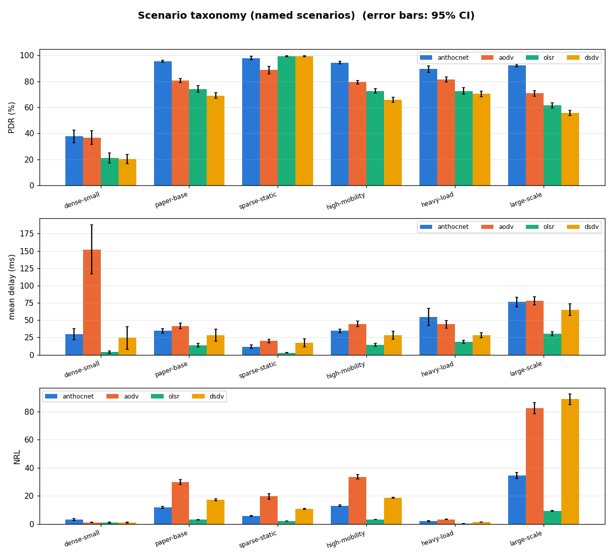

# Benchmarks

Two regimes, two suites, one protocol build ([ADR-0015](adr/0015-satellite-substrate-lives-in-the-image.md)
— the build never forks; only the scenario harness and the baselines change):

| Regime | Suite | Baselines | Status |
|---|---|---|---|
| **MANET** (original) | this page — discrete taxonomy + sweeps, wifi field | AODV / OLSR / DSDV, plus the **oracle** upper bound ([#415](https://github.com/swarm-routing/AntHocNet/issues/415)) on the [grid](benchmarks/grid.md#the-oracle-control-how-much-of-the-shortfall-is-routing) | nightly refresh + manual campaigns |
| **Satellite** (ISL) | [satellite/isl-grid.md](benchmarks/satellite/isl-grid.md) — +Grid torus, point-to-point ISLs | same, plus the **exact** (`approx=0`) oracle control — the [#216](https://github.com/swarm-routing/AntHocNet/issues/216) gap, now closed by v1.5.0 phase 3 | manual dispatch + per-PR analytic anchor/determinism gates; results published on that page |
| **Satellite** (moving LEO) | [satellite/leo-walker.md](benchmarks/satellite/leo-walker.md) — Walker shells on stock ns-3.48 LEO mobility, scheduled handovers, ISL failures | AODV, an idealised greedy-geographic arm, the hop oracle and the **delay oracle** latency bound; calibrated against Hypatia and LENS | manual dispatch + the 3.48 CI smoke (geometry anchors, outage books, determinism) |

A number is only comparable **within** its regime — the regimes differ in what
routing even has to solve ([network-regimes.md](network-regimes.md)). Everything
below this table is the **MANET** suite.

> **Offered load before [#521](https://github.com/swarm-routing/AntHocNet/issues/521).** Until the #521 fix, every
> source ran ns-3's default 1 s on / 1 s off, so each cell was offered **half**
> its stated CBR rate. Comparisons between protocols within a cell stand,
> because every arm saw the same schedule. Absolute values on pages measured
> before the fix are not "at the stated load". See
> [methodology § #521](benchmarks/methodology.md#521-the-sources-were-not-cbr-before-the-fix).

AntHocNet measured against the standard NS-3 MANET routing protocols
(**AODV**, **OLSR**, **DSDV**) on identical scenarios — same node layout,
mobility and traffic, driven from the same RNG runs so every protocol sees the
same realisations. Metrics come from an NS-3 `FlowMonitor`. This page is the
index: the headline cross-scenario summary, plus a link to every detail page.

| Page | What is on it |
|---|---|
| [metrics.md](benchmarks/metrics.md) | What PDR, mean delay, delay99, jitter, dOff50/dOff90, throughput, NRL and `nrl_bytes` mean — and their caveats (#57/#54 survivorship, #132), including the phase-3 rule that **`delay99` must not be compared across arms whose PDR differs materially** (use `##COMMON##` `p99C`) and how to read the oracle arm's asserted-zero NRL. |
| [methodology.md](benchmarks/methodology.md) | Reproduce commands, the scenario taxonomy & sweeps, ns-3 build profiles (`default` vs `release`/`-opt`, #123), and the validation anchors + #59 enforcement / #129 determinism gate. |
| [core-speed.md](benchmarks/core-speed.md) | The core's own cost per operation (pheromone update, next-hop choice, codec, dedup), with no simulator, tracked on every merge (#620). |
| **Scenarios** | |
| [dense-small](benchmarks/scenarios/dense-small.md) | dense / low-mobility — the fast CI regime; AntHocNet's hard case. |
| [paper-base](benchmarks/scenarios/paper-base.md) | sparse / mobile — the paper's base scenario (AntHocNet's design regime). |
| [sparse-static](benchmarks/scenarios/sparse-static.md) | sparse / static — connectivity-limited but stable (pause=900). |
| [high-mobility](benchmarks/scenarios/high-mobility.md) | sparse / high-mobility — constant motion (pause=0). |
| [heavy-load](benchmarks/scenarios/heavy-load.md) | dense / heavy-load — many flows / higher CBR. |
| [large-scale](benchmarks/scenarios/large-scale.md) | large / mobile — 100 nodes. |
| [disaster](benchmarks/scenarios/disaster.md) | disaster / emergency response — responder teams by role (Aschenbruck et al. 2007) around a mall with two walled fire compartments; AntHocNet, AODV, OLSR and the oracle (#580). |
| [partition-merge](benchmarks/scenarios/partition-merge.md) | stress — two teams and a bridge that withdraws and returns; the bounded-control CI gate for the #20/#45 storm class (#62). |
| **Sweeps** | |
| [area](benchmarks/sweeps/area.md) | Paper Fig. 1 — long edge 1500→2500 m. |
| [pause](benchmarks/sweeps/pause.md) | Paper Fig. 2 — pause time 0→900 s. |
| [scale](benchmarks/sweeps/scale.md) | Paper Fig. 3 — terrain ×f, nodes ×f² (50→200 nodes). |
| **Grid** | |
| [mobility × channel](benchmarks/grid.md) | **Restated on CBR sources ([#521](https://github.com/swarm-routing/AntHocNet/issues/521)):** AntHocNet beats AODV on PDR, NRL and `delay99` in all six cells (paired, p ≤ 5.5 × 10⁻⁴) and leads delivery everywhere; on two-ray it now delivers *more* than the link-blind `approx=1` oracle (+0.58…+0.67 pp), so the oracle's delivery is a bound on the Nakagami cells only; under Nakagami DSDV's NRL drops below AntHocNet's. The pre-#521 record follows: the six-cell grid — {rwp, ssrwp, gaussmarkov} × {tworay, nakagami} — re-baselined at `dd171e5e` after the [#496](https://github.com/swarm-routing/AntHocNet/issues/496) hello-timer fix (`TimerJitter = 0.05`, `ReconvHoldCap = 200 ms`), with the oracle in the same dispatch; the oracle reproduces the pre-#496 #431 table in 6 / 6 cells, which is the attribution control. **AntHocNet beats AODV on PDR, NRL and `delay99` in all six cells** (paired, p ≤ 9.6 × 10⁻⁵) and leads delivery everywhere (+6.1…+13.3 pp over OLSR, whose column is offered-based since [#510](https://github.com/swarm-routing/AntHocNet/issues/510)); it sits 0.23–1.09 pp below the oracle on two-ray and 5.4–7.9 pp below it under Nakagami. **Scoped** ranking-stability statement: AntHocNet first in delivery and the overhead ordering (`olsr < anthocnet < dsdv < aodv`) stable everywhere; the AODV–OLSR delivery order is cell-dependent (AODV ahead in gaussmarkov-tworay since #510, OLSR ahead in the other five); the tail depends on the channel — OLSR best under two-ray (AntHocNet second), AntHocNet best under fading (OLSR worst). The v1.5.0 phase-3 oracle analysis (gap decomposition, `approx=1` quoting rule) stays on the page as the pre-#496 record. Not comparable with the pages above. |
| **Transport** | |
| [tcp](benchmarks/tcp.md) | v1.4.0's TCP arm — goodput over `TcpCubic` at the paper base scenario, 20 seeds + a 20-seed UDP control. The delivery ranking **reorders** under TCP (AODV 3rd → last, DSDV rises, anthocnet–olsr a statistical tie): a transport-layer claim that does not name its transport is unsupported. Measured *after* `v1.3.0`. |
| [static mesh](benchmarks/static-mesh.md) | The static Wi-Fi mesh family ([#484](https://github.com/swarm-routing/AntHocNet/issues/484)): the paper field with no mobility, 20 seeds, with the exact oracle. At v2.3.0 defaults (quiet mode on, [#571](https://github.com/swarm-routing/AntHocNet/issues/571)): AntHocNet delivers **99.33 %** and beats AODV on every metric: 97.28 % PDR, a 9.6 ms vs 215.7 ms delay99, and 4.11 vs 17.53 NRL. OLSR still leads at 99.82 % and 1.78 NRL. v2.2.0's AntHocNet (quiet mode off) read 99.34 % and NRL 4.51. The pre-#496 numbers (88.0 %, the [#494](https://github.com/swarm-routing/AntHocNet/issues/494) `ReconvHoldCap` finding) were the timer artifact: paired +11.28 pp, 20/20 seeds. Measured *after* `v1.6.0`. |
| [VANET](benchmarks/scenarios/vanet.md) | The VANET family ([#301](https://github.com/swarm-routing/AntHocNet/issues/301)): `--scenario=vanet`, 100 vehicles on an 800 × 800 m Manhattan street grid with building shadowing, seven arms (GPSR and the 100 ms per-pair oracle included), 20 seeds, plus a partition-bound sparse cell. **AntHocNet ties AODV on delivery** (42.10 vs 42.26 %, p = 0.34) with half AODV's `delay99` but +13.1 NRL; GPSR, AOMDV, DSDV and OLSR trail both. The oracle delivers 81.7 %, the widest gap of any family: AntHocNet loses 36 % of its traffic to reconvergence as buildings break links at every corner ([#537](https://github.com/swarm-routing/AntHocNet/issues/537)). The page carries the **four-family ranking-stability statement** (MANET, static mesh, FANET, VANET). |
| [FANET](benchmarks/scenarios/fanet.md) | The FANET family ([#300](https://github.com/swarm-routing/AntHocNet/issues/300)): `--scenario=fanet`, 30 UAVs in a 1000 × 1000 × 300 m box, 3-D Gauss-Markov at 10–30 m/s, six arms (AOMDV and the 100 ms oracle included), 20 seeds, plus a partition-bound sparse cell. **AntHocNet leads every protocol in both cells:** on CBR sources ([#521](https://github.com/swarm-routing/AntHocNet/issues/521)) it delivers 94.43 % in the main cell, 2.45 pp below the oracle and +8.32 pp over AODV, with lower NRL, `delay99` and energy per bit than AODV. OLSR and DSDV collapse on stale next hops at these speeds. The OLSR column is offered-based ([#510](https://github.com/swarm-routing/AntHocNet/issues/510)). There is no geographic arm in 3-D. A 3-D cell is not comparable with the planar pages. |
| **Protocol arms** | |
| [reinjection](benchmarks/reinjection.md) | v1.5.0 phase 2 — the [#46](https://github.com/swarm-routing/AntHocNet/issues/46) MAC-failure detector's first 20-seed publishable A/B (ΔPDR **+5.55 / +6.54 pp**, 20/20 sign-consistent), the direct measurement that **~65–67 %** of its re-injections are of already-delivered packets, the detector-off reorder collapse (0.1745/0.2301 → 0.0010/0.0009) that pins AntHocNet's fading reordering on duplicates, and the `MaxReinjectPerPacket` cap frontier — measured at `7471447`, shipped default unchanged. |
| **Campaign plans** | |
| [v1.5.0 re-baseline](benchmarks/v1.5.0-campaign.md) | The campaign — how the hold-cap flip, the re-injection cap sweep, the publishable detector A/B and the oracle control folded into **one** ordered set of dispatches instead of three overlapping ones. **Complete (2026-08-14): all three measurement phases published.** Flip merged as #411, grid re-baselined at `a1daa7a`, cap × detector measured at `7471447` with no default change ([reinjection.md](benchmarks/reinjection.md)), and [phase 3](benchmarks/v1.5.0-campaign.md#phase-3-the-oracle-control) — the oracle control at `40b434d`, six grid cells plus the satellite torus, three a-priori assertions passing at 20 seeds, the hop rule passing *vacuously* where a naive version would have failed. |
| [v2.2.0 re-baseline](benchmarks/v2.2.0-campaign.md) | The pre-registered plan for v2.2.0's one campaign (#565): `RepairHoldCap` (#433), the SINR metric (#181) and the VANET reconvergence knobs (#537), each A/B'd against one control generation in all 18 published cells, with the ADR-0019 rule for when a default moves. **Complete: no default moved** ([results](benchmarks/v2.2.0-campaign.md#results)). |
| [v2.3.0 mechanisms](benchmarks/v2.3.0-campaign.md) | The v2.3.0 campaign: link-lifetime prediction (#574), quiet mode (#571), adaptive evaporation (#572), the energy metric (#145), the satellite timing profile (#205) and the ISL hello throttle (#204), each paired against one control generation in every family (18 cells, 20 seeds), under v2.2.0's rule plus "must improve its target family". **Complete: quiet mode moves on by default** (static-mesh NRL −8.6 %, no regression in any cell); the other five ship selectable and off. The family pages carry the restated v2.3.0 numbers. |
| [v2.4.0 control](benchmarks/v2.4.0-campaign.md) | The v2.4.0 control campaign: every family re-baselined on its native comparators ([ADR-0026](adr/0026-baselines-are-family-native.md)), with the migrant arms retired and the four new comparators (HWMP, GPCR, gpsr3d, OPSPF) at 20 seeds. One arm, no default decided. **Pre-registered, not yet dispatched.** |
| [v2.5.0 comparators](benchmarks/v2.5.0-comparators.md) | The adaptive-routing comparators (#563): ARA, Termite and Q-routing, each anchored on its own paper's trend (ARA vs AODV over pause, Termite's goodput and path length over speed, Q-routing vs the oracle at low and high load), then run alone on the v2.4.0 control cells and read paired by seed against AntHocNet, the oracle and the best native. No default decided. **Complete (2026-10-28):** ARA passes its anchor and counts; it beats AntHocNet by about 1 pp on the two-ray grid at a fifth of the overhead and a 0.9 s higher tail delay, and loses 2 to 7 pp on fading channels. Termite and Q-routing miss their anchors and ship as infeasibility verdicts. |
| [v2.6.0 harness control](benchmarks/v2.6.0-harness-control.md) | The byte-identical control for the harness move into `routing-bench` (#769, ADR-0027 §4): seeds 1–2 of every committed v2.4.0/v2.5.0 MANET-family cell re-run through `routing-compare`. **Complete (2026-10-29):** 37 of 37 cells, 726 `##RUN##`/`##ROUTE##`/`##COMMON##` rows, equal byte for byte. No number moved. |
| [v2.7.0 BeeAdHoc anchor](benchmarks/v2.7.0-beeadhoc-anchor.md) | The BeeAdHoc arm's anchor (#800), pre-registered on the PG 460 report's ch. 7 setup (100 nodes, 3000 × 1000 m, pause 1–1000 s) against AODV and DSDV, 10 seeds, with and without the expanding ring. **Complete (2026-11-01): MISS, 3 of 5.** NRL below AODV everywhere and below DSDV only while nodes keep moving; lowest energy per packet, highest PDR, but 120–280 ms more delay. The arm ships as an infeasibility verdict. |
| [v2.7.x image control](benchmarks/v2.7.x-image-control.md) | The cross-image control for the move to the `ns3-dev` campaign image ([#867](https://github.com/swarm-routing/AntHocNet/issues/867)): one v2.4.0 cell per family, 20 seeds, on the recorded image (`old`) and the campaign image (`dev`), both at `b531d5d`. **Complete (2026-11-10):** the old arm reproduces all 17 published cells byte for byte; dev vs old reads `PAIRED-NOISE` for every protocol in the ISL, LEO and SAGIN cells and not in the five MANET-type families. The cross-image rule in [methodology](benchmarks/methodology.md#reproducing-via-ci-manual-dispatch) is proposed, awaiting the maintainer. |
| **Satellite suite** | |
| [satellite/isl-grid.md](benchmarks/satellite/isl-grid.md) | The ISL-grid regime: harness, analytic anchors, how to dispatch — and the [#216](https://github.com/swarm-routing/AntHocNet/issues/216) result, including the **only cell where the oracle is exact** (`mode=wired approx=0`: the graph *is* the wiring, so the bound is proven rather than approximate). The MANET grid's oracle numbers are `approx=1` and cannot be read that strongly. |
| [satellite/leo-walker.md](benchmarks/satellite/leo-walker.md) | The moving constellation ([#297](https://github.com/swarm-routing/AntHocNet/issues/297)): walker16, Starlink S1 and an S1 mass-failure storm at 20 seeds. AntHocNet beats AODV by +15.5 / +28.2 / +32.3 pp PDR and loses 9–11 packets per scheduled handover against AODV's 35–58; the handover metric family, the geo-greedy verdict, and the Hypatia and LENS calibration deltas. |
| [satellite/sagin.md](benchmarks/satellite/sagin.md) | Space-air-ground ([#581](https://github.com/swarm-routing/AntHocNet/issues/581)): the LEO shells with a HAPS layer between the stations and the shell (`leo-walker --sagin`); AntHocNet, OPSPF, geo-greedy and gpsr3d against the hop and delay oracles. Pre-registered, campaign pending. |
| [benchmarks/README.md](benchmarks/README.md) | How the figures and this folder are generated. |

## Results

The summary below and the per-scenario pages it links to are regenerated and
proposed automatically (a `bot/benchmarks` PR) by the nightly `benchmarks`
workflow whenever the code on the default branch changed (it runs the discrete
named scenarios across all baselines and renders
[`benchmarks/discrete-summary.png`](benchmarks/)), so they track the current
code. The heavier parameter sweeps are campaigns on `benchmark-cell`.

> **Cross-image note ([#977](https://github.com/swarm-routing/AntHocNet/issues/977)).**
> The table is measured in the campaign image of the stamped commit: ns-3
> 3.48, release profile, gcc-13 ([#866](https://github.com/swarm-routing/AntHocNet/issues/866);
> 3.48 while [#843](https://github.com/swarm-routing/AntHocNet/issues/843) is
> open). Up to [`5462fb5`](https://github.com/swarm-routing/AntHocNet/commit/5462fb5)
> it was measured on ns-3 3.42 (`ghcr.io/danieljoppi/ns3:3.42`, gcc-11,
> default profile). Under the
> [cross-image rule](benchmarks/methodology.md#reproducing-via-ci-manual-dispatch) (accepted 2026-11-11, #867)
> those are different ns-3 releases, and the 3.42 → 3.48 move alone shifts
> delay tails and NRL in these MANET families
> ([#915](https://github.com/swarm-routing/AntHocNet/issues/915); upstream or
> regression: [#923](https://github.com/swarm-routing/AntHocNet/issues/923)).
> So **no delta is quoted between the table and the last 3.42 table**, which
> stays below as [superseded](#superseded-the-last-ns-3-342-table) (ADR-0013).
> Each generated block names the image digest and ns-3 release it was measured on.

> **Reading the table below.** It is regenerated by the nightly `benchmarks`
> workflow, so it reflects `main` as of the stamped commit — including the three
> protocol corrections of July 2026:
> [#88](https://github.com/swarm-routing/AntHocNet/issues/88) (`T_hop` 50 ms → 3 ms),
> [#169](https://github.com/swarm-routing/AntHocNet/issues/169) (the reactive
> broadcast budget was a hop limit on discovery, not a flood bound) and
> [#173](https://github.com/swarm-routing/AntHocNet/issues/173) (removing it left
> the flood unbounded in dense graphs), plus v1.1.0's two-factor acceptance band
> ([#177](https://github.com/swarm-routing/AntHocNet/issues/177)).
>
> **20 seeds per scenario, paired by construction** (#977). Every protocol of
> a scenario runs on the same realisation per seed (seeds 1–20, 120 s), and ±
> is the 95% CI half-width. That is the org's comparison floor (paired,
> ≥ 20 seeds); a claim about a gap between two columns still comes from the
> paired per-seed deltas (`scenarios-runs.csv` in the run's artifact, through
> ns3-tools `bench_parse`), not from two overlapping intervals.
>
> The **sweep** pages are a separate, older vintage — produced by the manual
> campaign workflow, not regenerated on merge, and each carries its own vintage
> note. [fidelity.md](fidelity.md) holds the standing correction record.

<!-- NOTE TO EDITORS: do not quote values from the generated table in the prose
     above. The table is machine-updated nightly; this paragraph is not,
     so any number written here goes stale silently and then contradicts the
     table three lines below it. That has now happened four times (#175, #189,
     #220, and again after the v1.1.0 refresh). Describe what to look for, not
     what the values are. -->

<!-- BENCHMARK-TABLE-START -->
_Scenario taxonomy — **PDR % ± 95% CI**, mean of 20 run(s) per scenario, every baseline on identical realisations. Full per-scenario metrics (delay, tail, NRL, jitter) are on the linked pages. Generated by `run-scenarios.py`; charts by `make-charts.py`._

_Measured at [`f3084e7`](https://github.com/swarm-routing/AntHocNet/commit/f3084e70b5aa0ccc22434c980b3505eb034d897b) on `ghcr.io/swarm-routing/anthocnet-dev@sha256:1d798f77aeab25f6a9a66c36cbd15bc28599820a9fbdc0bd614449dc63627b03`, ns-3 3.48, [run](https://github.com/swarm-routing/AntHocNet/actions/runs/43589990990)._

| scenario | class | anthocnet | aodv | olsr | dsdv |
|---|---|---:|---:|---:|---:|
| [dense-small](benchmarks/scenarios/dense-small.md) | dense / low-mobility | 37.7 ± 4.8 | 36.7 ± 5.2 | 21.2 ± 3.9 | 20.3 ± 3.6 |
| [paper-base](benchmarks/scenarios/paper-base.md) | sparse / mobile | 95.4 ± 0.7 | 80.6 ± 1.7 | 74.1 ± 2.5 | 69.0 ± 2.2 |
| [sparse-static](benchmarks/scenarios/sparse-static.md) | sparse / static | 97.9 ± 1.3 | 88.7 ± 3.0 | 99.4 ± 0.4 | 99.2 ± 0.4 |
| [high-mobility](benchmarks/scenarios/high-mobility.md) | sparse / high-mobility | 94.4 ± 0.9 | 79.3 ± 1.4 | 72.6 ± 1.9 | 65.9 ± 1.9 |
| [heavy-load](benchmarks/scenarios/heavy-load.md) | dense / heavy-load | 89.4 ± 2.6 | 81.3 ± 2.0 | 72.6 ± 2.6 | 70.3 ± 2.1 |
| [large-scale](benchmarks/scenarios/large-scale.md) | large / mobile | 92.2 ± 1.0 | 70.7 ± 2.0 | 61.6 ± 2.0 | 55.6 ± 1.9 |

<!-- BENCHMARK-TABLE-END -->

### Superseded: the last ns-3 3.42 table

Kept for the record (ADR-0013), **not for comparison** with the table above
(different ns-3 release; see the cross-image note). Mean of 10 runs per
scenario at 120 s, measured at
[`5462fb5`](https://github.com/swarm-routing/AntHocNet/commit/5462fb5)
on `ghcr.io/danieljoppi/ns3:3.42` (ns-3 3.42, gcc-11, default profile),
[run](https://github.com/swarm-routing/AntHocNet/actions/runs/42523494595);
PDR % ± 95% CI. Its per-scenario pages are in the git history at that commit.

The table

| scenario | class | anthocnet | aodv | olsr | dsdv |
|---|---|---:|---:|---:|---:|
| [dense-small](https://github.com/swarm-routing/AntHocNet/blob/5462fb56c71ceb1981078cc0cb86e940681e5d9f/docs/benchmarks/scenarios/dense-small.md) | dense / low-mobility | 38.4 ± 6.1 | 38.6 ± 7.9 | 22.1 ± 5.3 | 20.2 ± 5.6 |
| [paper-base](https://github.com/swarm-routing/AntHocNet/blob/5462fb56c71ceb1981078cc0cb86e940681e5d9f/docs/benchmarks/scenarios/paper-base.md) | sparse / mobile | 94.4 ± 1.5 | 78.7 ± 3.6 | 71.8 ± 3.5 | 67.2 ± 2.8 |
| [sparse-static](https://github.com/swarm-routing/AntHocNet/blob/5462fb56c71ceb1981078cc0cb86e940681e5d9f/docs/benchmarks/scenarios/sparse-static.md) | sparse / static | 96.0 ± 3.1 | 88.8 ± 4.1 | 99.4 ± 0.4 | 98.5 ± 1.5 |
| [high-mobility](https://github.com/swarm-routing/AntHocNet/blob/5462fb56c71ceb1981078cc0cb86e940681e5d9f/docs/benchmarks/scenarios/high-mobility.md) | sparse / high-mobility | 93.6 ± 0.9 | 77.8 ± 3.1 | 71.3 ± 3.0 | 65.6 ± 3.1 |
| [heavy-load](https://github.com/swarm-routing/AntHocNet/blob/5462fb56c71ceb1981078cc0cb86e940681e5d9f/docs/benchmarks/scenarios/heavy-load.md) | dense / heavy-load | 88.6 ± 3.3 | 78.5 ± 2.8 | 70.8 ± 2.7 | 68.1 ± 3.1 |
| [large-scale](https://github.com/swarm-routing/AntHocNet/blob/5462fb56c71ceb1981078cc0cb86e940681e5d9f/docs/benchmarks/scenarios/large-scale.md) | large / mobile | 91.3 ± 2.3 | 71.8 ± 2.6 | 61.4 ± 3.7 | 55.4 ± 4.6 |

## Results by family

The scenario table above is the MANET taxonomy. Each supported family has its
own results page, compared against that family's own protocols plus its oracle
([ADR-0026](adr/0026-baselines-are-family-native.md)), with the same AntHocNet
configuration everywhere (ADR-0019). The chart puts them side by side in the
two terms that need no migrated protocol: AntHocNet's gap to each cell's
oracle, and to its best native baseline, paired per seed
([#711](https://github.com/swarm-routing/AntHocNet/issues/711); the
[v2.4.0 control campaign](benchmarks/v2.4.0-campaign.md#results)). The
ranking-stability statement that reads it is on the
[VANET page](benchmarks/scenarios/vanet.md#ranking-stability-across-the-families).

_Reproduce: `make reproduce FIG=families-native` re-renders it from the committed data and diffs the PNG ([#621](https://github.com/swarm-routing/AntHocNet/issues/621))._

| family | page | chart |
|---|---|---|
| MANET grid (3 mobility × 2 channel) | [grid.md](benchmarks/grid.md#restated-on-cbr-sources-521) | [grid.png](benchmarks/charts/grid.png) |
| static Wi-Fi mesh | [static-mesh.md](benchmarks/static-mesh.md#restated-on-cbr-sources-521) | [family-static-mesh.png](benchmarks/charts/family-static-mesh.png) |
| FANET | [fanet.md](benchmarks/scenarios/fanet.md#restated-on-cbr-sources-521) | [family-fanet.png](benchmarks/charts/family-fanet.png) |
| VANET | [vanet.md](benchmarks/scenarios/vanet.md) | [family-vanet.png](benchmarks/charts/family-vanet.png) |
| satellite ISL grid | [isl-grid.md](benchmarks/satellite/isl-grid.md#re-measured-with-arm-independent-flow-schedules-517) | [satellite.png](benchmarks/charts/satellite.png) |
| moving LEO constellation | [leo-walker.md](benchmarks/satellite/leo-walker.md) | [constellation.png](benchmarks/charts/constellation.png), [calibration-hypatia.png](benchmarks/charts/calibration-hypatia.png) |

These charts are drawn from the committed cells under
[`results/cells/`](../results/cells/) by `ns3/tools/family-charts.py`. The
**Charts** workflow re-renders them (and the sweep charts, from the campaign
CSVs their pages cite) on every change to that data or to the chart code, and
commits the result; the Pages site redeploys after it. Re-measuring a page
means committing the new cell and pointing the script's cell table at it.

## How to read this

These are MANET results: PDR and delay depend heavily on node density,
mobility and offered load, and single-seed runs are noisy — hence the
multi-run averaging. AntHocNet is a research protocol; AODV/OLSR/DSDV are
mature, heavily-tuned implementations. The point of this harness is a fair,
repeatable **re-validation** that AntHocNet routes and delivers in the same
regime as the established protocols, not a claim that any one protocol always
wins. Cross-simulator parity was never claimed while an NS-2 adapter existed
either — the MAC/PHY models differ (see [cross-validation.md](cross-validation.md),
now historical).

Absolute numbers carry a further caveat: they are gated on the validation
anchors, and the *relative* comparison (identical per-protocol realisations) is
the part that is valid throughout — see
[methodology.md](benchmarks/methodology.md#validation-anchors-known-expected-results).
