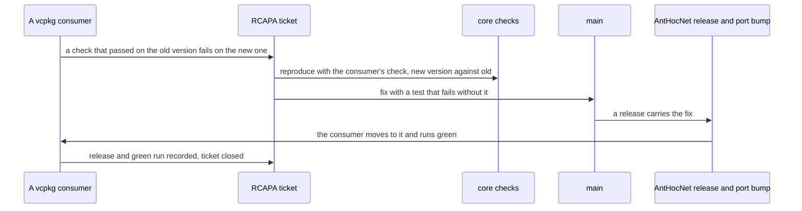

# RCAPA: regressions in a release of swarm-routing/AntHocNet

An **RCAPA** (root cause analysis with corrective and preventive actions) is
the full record of one **regression in a published library**: a version of
it that another project consumes (a release pinned by a lock, PyPI, a vcpkg
port) worked, and a later one broke. A bug or change that never reached a
published version needs none (an ordinary `bug` issue is enough), a Docker
image needs one only when its composition is the cause, and an upstream
ns-3 bug is an `NS3-NNN` in swarm-routing/ns3-tools. The org's rule and its decision table are in
[CONTRIBUTING.md, "RCAPA"](https://github.com/swarm-routing/.github/blob/main/CONTRIBUTING.md#rcapa)
([ADR-0003](https://github.com/swarm-routing/.github/blob/main/docs/adr/0003-rcapa-for-ns3-bugs-and-released-regressions.md)).
This page is the project's flow and its index.

## The flow for this project

The library other projects would consume from AntHocNet is its simulator-free
`core/`, through the `anthocnet-core` vcpkg port. That port is not published yet (it
waits in swarm-routing/vcpkg-registry `templates/` until a release installs
`core/` as a CMake package), so **RCAPA does not apply yet**: the flow below
starts with the first published port version. The ns-3 module, the GitHub
releases and their Zenodo DOIs are not consumed at a version by another
project; a defect there is an ordinary `bug` issue.

AntHocNet is the org's main **consumer**: when one of its lock bumps breaks
it (`swarm-core.lock`, `ns3-tools.lock`), the RCAPA belongs to that library,
an `SWC-NNN` in swarm-routing/ns3-swarm-core or an `NST-NNN` in
swarm-routing/ns3-tools, opened from AntHocNet's finding and verified with
AntHocNet's failing check.

| | |
|---|---|
| Published as | nothing yet: the `anthocnet-core` vcpkg port, from its first published version |
| ID prefix | `AHN-NNN` |
| Ticket | an issue in swarm-routing/AntHocNet, form *Regression in a release (RCAPA)*, title `[rcapa] AHN-NNN <short description>`, labels `rcapa` and `bug`, opened from the consumer's finding |
| Verified by | the consumer's failing build or test against the `anthocnet-core` version that broke and the one before it; then `make test` (core ctest), and in CI `ci-core.yml` (`core`, `core-sanitizers` under ASan + UBSan, `codec-fuzz`) and the ns-3 gates of `ci-ns3.yml` |
| Corrective action | the fix PR with a core unit test in `core/tests/` that fails without it (golden rule 7); a wire-format change bumps `kWireVersion` (golden rule 4); then a release and the port bump org-bot opens in swarm-routing/vcpkg-registry |
| Preventive action | the core test or fuzz case that would have caught it, and a consumer case in swarm-routing/vcpkg-registry `test/consumer/` if only a consumer showed it |
| Closes when | a release carries the fix **and** the `anthocnet-core` port is bumped to it in the registry, with the consumer that found it green on the new baseline |

## Index

| ID | RCAPA | RCAPA ticket | Fixed in |
|----|-------|--------------|----------|

## Adding one: the ticket first

1. Open the RCAPA ticket (the table above). `NNN` is the next free number in
   the index.
2. Copy [`_template.md`](_template.md) to `rcapa-<short-description>.md`
   (lowercase, hyphens: what breaks, not where it was found), and add its row
   to the index in the same pull request.
3. The ticket stays open until a release carries the fix, the `anthocnet-core` port is bumped to it in swarm-routing/vcpkg-registry, and the consumer that found it runs green on the new baseline; record the release and the baseline in the index.

## What an RCAPA answers

1. **What broke, in which release, and who did it touch?** The symptom, the
   releases that fail and the last that passes, the users, numbers or
   downstream pins it affects.
2. **How do I see it myself?** Exact commands, the release or commit, an
   image by tag and digest when one is involved, seeds, expected against
   actual.
3. **Why did it happen, and why did our checks let it into a release?** Five
   whys, each citing its evidence: a source line at a named commit, a log, a
   run, a comment. An answer without a source is a hypothesis and says so.
4. **What does it look like?** Mermaid diagrams: the failing call chain, the
   types or components involved.
5. **What did we do about it?** Corrective actions (the fix, its PR, the
   release that carries it) and preventive actions (the test or check that
   catches a recurrence). An action not done yet is an open issue, linked.
6. **When?** A dated timeline and every link.

## Writing one

- Every issue and PR reference is fully qualified: `swarm-routing/<repo>#N`,
  also for this repository's own items; an ns-3 item is a link whose text is
  `nsnam/ns-3-dev#N` to its full gitlab.com URL. Never a bare number with a
  hash. In a mermaid block, which cannot hold a hash, name the item in words.
- Mermaid: no HTML entities inside a block; write template arguments as
  words.
- An RCAPA is never deleted. Later findings update its status and timeline.
